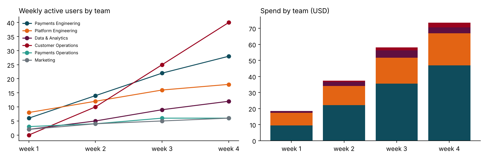

# governed-ai-gateway

**An internal AI platform for a regulated fintech: one governed way for every team to use AI models, and the
practices to run it as a product.**

Teams point their SDKs and AI coding assistants at the gateway (it speaks the OpenAI-compatible chat API) with a
team key. For every request the gateway:

1. **authenticates** the team's key (only a hash is stored; keys expire and revoke within seconds);
2. **applies the team's policy**: approved models, approved agent tools, which require a human approval, output caps;
3. **protects data**: finds IBANs, card numbers, emails, phone numbers and secrets; **redacts** them so the
   provider never sees them and **restores** them in the answer (also when streamed), or **blocks** the request;
4. **rate-limits** per key in Redis, shared by all replicas;
5. **reserves budget** for the request's worst-case cost, so concurrent requests can never overspend a team;
6. **routes** to the model's providers with fallback and circuit breakers;
7. **settles the cost**, writes the usage ledger and a **hash-chained audit entry** (hashes of prompts, never
   prompts), and exports Prometheus metrics.

Policies are YAML in this repository ([example](policies/fintech-example.yaml)), changed by pull request, tested,
and every policy in force is recorded by hash in the audit trail.

```
 AI coding assistants      ┌──────────────────────── governed-ai-gateway ────────────────────────┐     Anthropic
 SDKs, agents, scripts ──▶ │ key ─▶ policy ─▶ redact/block ─▶ rate limit ─▶ budget ─▶ route+fallback│ ──▶ backup account
 (OpenAI-compatible API)   │        (YAML,     (IBAN, card,     (Redis)       (Postgres   (breakers)   │     self-hosted model
                           │      reviewed)    email, secrets)               reservation)             │
                           │ ◀─ restore values ◀─ settle cost ◀─ usage ledger + hash-chained audit ◀─│
                           └──────────────── /metrics · /readyz · /admin (separate token) ───────────┘
```

## Evidence

Everything below comes from `aigw evaluate` ([reports/EVALUATION.md](reports/EVALUATION.md)); CI reruns it on
every push and daily, and `aigw gate` fails the build if a service-level objective is missed.

| Question | Result |
|---|---|
| Does data protection find regulated data? | **99.9% precision, 100% recall** on a held-out corpus of 1,000 cases in formats and wording never tuned on |
| ...without redacting order numbers? | the context rule for card look-alikes lifts precision from 88.5% to 100% on the development corpus |
| How much does the gateway add? | **10 ms p50, 16 ms p95** at 8 concurrent requests; one process sustains ~270 requests/s on 2 vCPUs |
| What if a provider goes down? | primary failing every call: **600 of 600** requests answered by the backup; the breaker opened |
| Can a burst overspend a budget? | **0% overspend** with reservations; check-then-spend overspent by 14-23% in the same test |
| Is the audit trail tamper-evident? | 8,986 entries verified; tests modify an entry and the chain names it |

**What the held-out set taught.** The first held-out run, before the fixes in this repository, found 69.6%
recall: card numbers at the end of a sentence (the trailing full stop), lower-case IBANs, German national phone
numbers, and Google and Stripe keys were missed. All four were fixed and the corpus regenerated with a new seed.
The same loop is the process for every missed format: add it to the held-out corpus first, then fix the detector.

## Running it as a product

A month of six teams adopting AI, simulated through the real gateway with mock models
([reports/USAGE.md](reports/USAGE.md)). This is the report leadership would get every month:



- 110 users, 8,972 requests, $187 spend; engineering use cases (coding, agents, code review, incident analysis)
  are 96% of it, while a customer-case summary costs $0.0007.
- Customer Operations sent customer cases to an external model with **4,449 values redacted** before they left.
- 36 requests refused for secrets or customer data where the policy forbids them; nothing echoed back.
- Data & Analytics passed 80% of its budget on 23 September and ran out on the 25th: 90 requests refused with a
  402 naming spend and limit, never a cent over.
- On the day the primary provider account failed half its calls, the backup absorbed 449 requests; 35 failed, all
  on a model whose policy had no backup provider. The report's action: add one.

The team side is in [docs/](docs):

| Document | What it covers |
|---|---|
| [Team charter](docs/team/CHARTER.md) | customers, ownership, measures for adoption, reliability, trust, cost and impact |
| [Operations](docs/team/OPERATIONS.md) | SLOs and error budget, failure modes, on-call, incident levels, runbooks |
| [Hiring and growth](docs/team/HIRING-AND-GROWTH.md) | structured interview loop, onboarding, 1:1s, development plans, performance |
| [Roadmap](docs/ROADMAP.md) | first 90 days as lead, quarterly goals with measures |
| [Build versus buy](docs/BUILD-VS-BUY.md) | criteria, options, recommendation per capability |
| [Adoption](docs/ADOPTION.md) | rolling out AI-assisted engineering and measuring impact without vanity metrics |
| [Decisions](docs/adr) | budget reservations, failure modes, redact-and-restore, no prompt storage, group commit |

## Run it

```bash
docker compose -f deploy/docker-compose.yml up --build      # gateway + PostgreSQL + Redis, mock models
deploy/smoke.sh                                              # team, key, redacted request, blocked request
```

```bash
pip install -e ".[dev]"
export AIGW_DATABASE_URL=postgresql://... AIGW_REDIS_URL=redis://... AIGW_ADMIN_TOKEN=...
export AIGW_POLICY_FILE=policies/fintech-example.yaml ANTHROPIC_API_KEY=...
aigw serve
aigw evaluate && aigw gate && aigw audit-verify
AIGW_TEST_DATABASE_URL=... AIGW_TEST_REDIS_URL=... pytest -q
```

Create a team and a key (`/admin/*` takes a separate admin token; every admin action is audited):

```bash
curl -X POST localhost:8080/admin/teams -H "X-Admin-Token: $AIGW_ADMIN_TOKEN" \
  -d '{"id":"payments","name":"Payments","policy":"engineering","monthly_budget_usd":500}'
curl -X POST localhost:8080/admin/keys -H "X-Admin-Token: $AIGW_ADMIN_TOKEN" -d '{"team_id":"payments","label":"ci"}'
```

## Layout

```
src/aigw/
  app.py          the request path, admin API, streaming with restore
  policy.py       policy as code: loading, validation, decisions
  dlp.py          detectors (validated: IBAN mod-97, Luhn + issuer), pseudonymisation, streaming restore
  limits.py       Redis token buckets (Lua), budget reservations and settlement, reaper
  providers.py    Anthropic and OpenAI-compatible adapters, mock model, circuit breakers, fallback routing
  audit.py        hash chain, group-commit writer, verification
  metrics.py      Prometheus metrics
  eval/           data-protection corpora, load/failover/budget tests, the simulated month
policies/         fintech example, demo (mock models)
deploy/           Dockerfile (non-root), docker compose, smoke test
docs/             team charter, operations, hiring, roadmap, build vs buy, adoption, ADRs
```

## Limits

- Data protection covers structured identifiers and secrets, not personal names or free-text addresses (roadmap:
  a self-hosted model). The corpora are synthetic, because real customer data cannot be published.
- Text only: images and tool-result messages are refused; tool definitions are forwarded to OpenAI-compatible
  providers only. Agent runtimes authorise tool calls through `POST /v1/tools/authorize`.
- The provider adapters are tested against recorded API shapes, not live accounts; the evaluations use mock models.
- Load numbers are from one process on a shared 2-vCPU machine; production runs several replicas.
